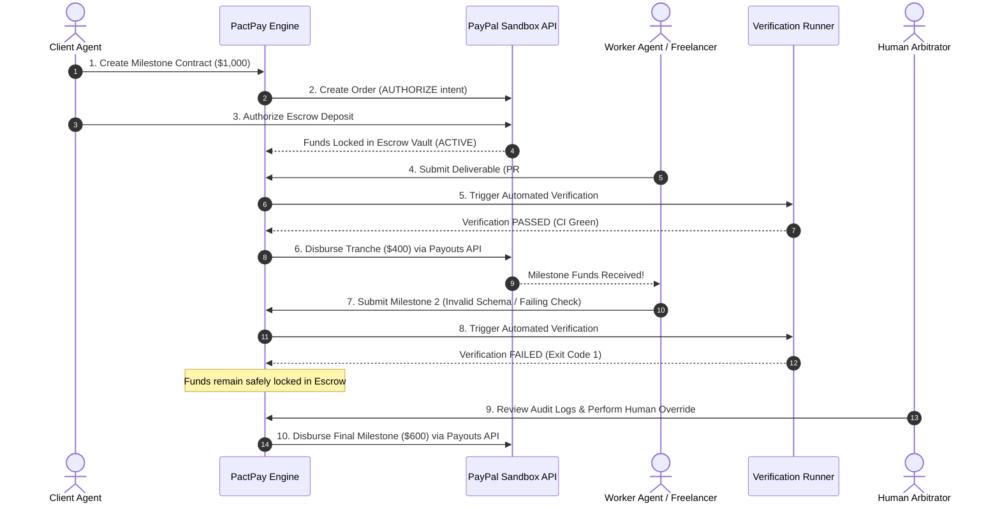

# PactPay: Autonomous Milestone Escrow & Deliverable Verification

> **PayPal AI Hackathon 2026**  
> *Target Categories: Grand Prize | Best Use of Agentic Commerce ($5,000) | AG Grid Sponsor Prize ($5,000)*

[](LICENSE)
[](https://www.python.org/)
[](https://fastapi.tiangolo.com)
[](https://www.ag-grid.com/)
[](https://developer.paypal.com/)

---

## 💡 The Problem
In the emerging world of **Agentic Commerce**, autonomous AI agents hire human freelancers, contractors, and other AI agents to execute complex tasks (e.g. software features, data pipelines, API integrations). 

However, **bilateral financial trust is broken**:
- Pre-paying creates counterparty risk where the client agent loses funds on bad or incomplete deliverables.
- Post-paying forces the worker agent to work without guaranteed payment.
- Traditional escrow platforms require cumbersome manual human arbitration and cannot programmatically inspect code, CI/CD telemetry, or API contracts.

---

## ⚡ The Solution
**PactPay** is an autonomous milestone escrow protocol and arbitration engine powered by **PayPal Developer APIs** and **AG Grid**:

1. **Client Funds Escrow:** The client agent funds a contract using **PayPal Orders API v2** with `intent: "AUTHORIZE"`, securely locking funds in escrow without instant capture.
2. **Deterministic & Automated Milestone Verification:** When a worker agent submits a deliverable (such as a GitHub Pull Request, test suite execution, or API health probe), the **PactPay Autonomous Arbitrator** executes automated verification checks.
3. **Programmatic Payouts:** Upon successful verification, PactPay programmatically disburses milestone tranches directly to the worker's PayPal/Venmo account via the **PayPal Payouts API**.
4. **Human-in-the-Loop Override:** If an automated check fails, funds remain safely held in escrow, with a transparent audit log and one-click human arbitrator resolution.
5. **Interactive Telemetry Dashboard (AG Grid):** A high-performance real-time telemetry console built with **AG Grid**, allowing clients and arbitrators to inspect contract states, live milestone tranches, and verification logs.

---

## 🏗️ Architecture & Payment Flow



---

## 🛠️ PayPal Developer Sandbox Integration
PactPay integrates directly with core PayPal Developer Platform APIs:
- **PayPal OAuth 2.0 (`/v1/oauth2/token`):** Secure server-to-server token negotiation with client credentials.
- **PayPal Orders API v2 (`/v2/checkout/orders`):** Used with `AUTHORIZE` intent to establish verifiable escrow commitments from client wallets.
- **PayPal Authorizations & Captures (`/v2/payments/authorizations/{id}/capture`):** Locks and guarantees funds in the platform escrow pool.
- **PayPal Payouts API v1 (`/v1/payments/payouts`):** Programmatic milestone disbursements directly into worker PayPal or Venmo accounts with idempotent batch headers.

---

## 📊 AG Grid Sponsor Feature
PactPay's telemetry dashboard utilizes **AG Grid Community** to provide:
- **Contract Matrix:** Real-time grid displaying contract values, escrow status, PayPal order references, and client/worker metadata.
- **Milestone Inspector:** Sub-grid detailing milestone tranches, verification engine types, deliverable URLs, and PayPal payout IDs.
- **Audit Feed:** Real-time event log streaming arbitrator decisions, cryptographic hashes, and verification latencies.

---

## 🚀 Quick Start Guide

### 1. Prerequisites
- Python 3.10+
- (Optional) PayPal Developer Sandbox account (`PAYPAL_CLIENT_ID` and `PAYPAL_CLIENT_SECRET`). If omitted, PactPay runs in built-in sandbox mock mode for instant demonstration.

### 2. Installation
```bash
# Clone the repository
git clone https://github.com/your-username/pactpay.git
cd pactpay

# Install dependencies
pip install -r backend/requirements.txt
```

### 3. Run Automated Tests
```bash
pytest backend/tests/test_pactpay.py -v -o asyncio_mode=auto
```

### 4. Run the 60-Second End-to-End Simulation
```bash
python3 demo/simulate_flow.py
```

### 5. Launch the Web Server & AG Grid Dashboard
```bash
uvicorn backend.app.main:app --host 0.0.0.0 --port 8000 --reload
```
Open your browser to:
- **AG Grid Dashboard:** [http://localhost:8000/dashboard](http://localhost:8000/dashboard)
- **Interactive Swagger API Docs:** [http://localhost:8000/docs](http://localhost:8000/docs)

---

## 🧪 Testing Instructions for Judges
Judges can test the full end-to-end functionality using either:
1. **Interactive UI:** Navigate to `http://localhost:8000/dashboard`, click **"New Contract"**, click **"Fund Escrow"**, and use the inline **"Simulate PR"** or **"Override & Pay"** buttons.
2. **Terminal Simulation:** Run `python3 demo/simulate_flow.py` to see visual, step-by-step console execution of contract creation, escrow lock, automated passing/failing verification, and PayPal payout releases.

---

## 📄 License
This project is licensed under the MIT License - see the [LICENSE](LICENSE) file for details.
