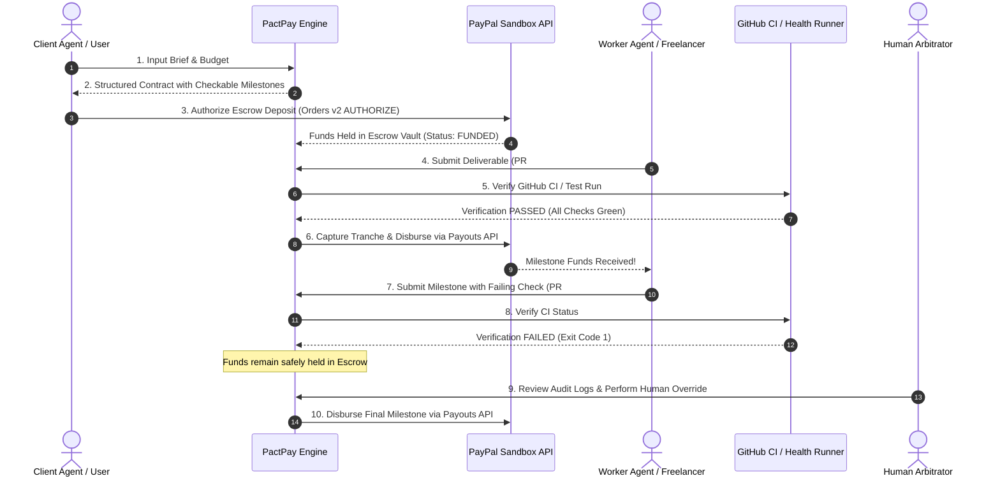

# PactPay: Autonomous Milestone Escrow & Deliverable Verification

> **PayPal AI Hackathon 2026**  
> *Target Categories: Grand Prize | Best Use of Agentic Commerce ($5,000) | AG Grid Sponsor Prize ($5,000)*

[](LICENSE)
[](https://www.ag-grid.com/)
[](https://developer.paypal.com/)

---

## 💡 The Problem
In the emerging world of **Agentic Commerce**, autonomous AI agents hire human freelancers, contractors, and other AI agents to execute complex tasks (e.g. software features, data pipelines, API integrations). 

However, **bilateral financial trust is broken**:
- Pre-paying creates counterparty risk where the client agent loses funds on bad or incomplete deliverables.
- Post-paying forces the worker agent to work without guaranteed payment.
- Traditional escrow platforms require cumbersome manual human arbitration and cannot programmatically inspect code, CI/CD telemetry, or API contracts.

---

## ⚡ The Solution
**PactPay** is an autonomous milestone escrow protocol and arbitration engine powered by **PayPal Developer APIs** and **AG Grid**:

1. **AI Contract Drafting (Gemini):** A client (person or AI agent) inputs a job brief. Gemini drafts a structured contract with machine-checkable milestones whose amounts add up to the budget.
2. **Client Funds Escrow:** The client funds the contract using **PayPal Orders API v2** with `intent: "AUTHORIZE"`, securely holding funds in escrow without immediate capture.
3. **Deterministic & Automated Milestone Verification:** When a worker submits a deliverable (such as a GitHub Pull Request or deployed endpoint URL), PactPay executes automated deterministic verification checks (CI green checks or HTTP probes). **The AI never arbitrarily decides whether money moves — deterministic checks do.**
4. **Programmatic Payouts:** Upon successful verification, PactPay captures that milestone's tranche and programmatically pays the worker via the **PayPal Payouts API**.
5. **Human-in-the-Loop Override:** If an automated check fails, funds remain held, Gemini explains the result in plain words to both sides, and the client can release anyway or reject the milestone (that share is returned by voiding the remaining authorization).
6. **Interactive Telemetry Dashboard (AG Grid):** A high-performance real-time telemetry console built with **AG Grid**, allowing clients and arbitrators to inspect contract states, live milestone tranches, and verification logs.

---

## 🏗️ Architecture & Payment Flow



---

## 🛠️ PayPal Developer Platform Integration
- **[PayPal Server SDK](https://www.npmjs.com/package/@paypal/paypal-server-sdk) (`@paypal/paypal-server-sdk`), Orders controller:** create an order with `intent: AUTHORIZE`, then authorize it after the client approves. Funds are held, not captured.
- **PayPal Server SDK, Payments controller:** one **partial capture** per milestone (`final_capture` on the last), and **void** to return what is left when a milestone is rejected.
- **PayPal Payouts API v1 (REST):** pays the worker each milestone's share. The Server SDK has no Payouts controller, so this one call uses REST directly, with idempotent request ids so a retry never pays twice.

## ✅ Verified in the PayPal sandbox
All four paths were run end to end against the live PayPal sandbox:
| Path | Result |
| --- | --- |
| Fund | Client approved $100 in PayPal checkout, funds authorized and held |
| Fail and hold | PR #1 fails CI, $0 released, $100 still held |
| Pass and pay | PR #2 passes CI, $60 captured and paid out (payout batch status SUCCESS) |
| Reject and refund | Milestone URL returns 404, client rejects, remaining authorization voided, $20 returned |

## 📊 AG Grid Sponsor Feature
PactPay's telemetry dashboard utilizes **AG Grid** to provide:
- **Contract Matrix:** Real-time grid displaying contract values, escrow status, PayPal order references, and client/worker metadata.
- **Milestone Inspector:** Sub-grid detailing milestone tranches, verification engine types, deliverable URLs, and PayPal payout IDs.
- **Audit Feed:** Event log of every funding, verification, capture, payout, override and void, with the evidence behind each decision.

---

## 🎬 Demo Job Repo for Video & Judges
- **Demo Job Repository:** [pactpay-demo-job](https://github.com/mithulpranav24012008/pactpay-demo-job)
  - **PR #1 (Failing CI):** Demonstrates automated failure detection — funds remain safely held in escrow, with detailed diagnosis.
  - **PR #2 (Passing CI):** Demonstrates automated verification pass — funds captured and disbursed instantly via PayPal Payouts.

---

## 🚀 Run it locally (about 5 minutes)

**Needs:** Node.js 22.5+ (uses the built-in `node:sqlite`), a free PayPal developer account, and a free Gemini API key.

1. **PayPal sandbox** (developer.paypal.com):
   - Testing Tools → Sandbox Accounts → create a **Business** account with Country **United States** (it sends payouts; payouts are not available from some countries, e.g. India).
   - Create two **Personal** US accounts: one pays as the client, one is paid as the worker.
   - Apps & Credentials → Sandbox → **Create App** on that US business account, with **Payouts** ticked. Copy the Client ID and Secret.
2. **Gemini key:** aistudio.google.com → Get API key (no card needed).
3. **Configure and start:**
   ```bash
   git clone https://github.com/mithulpranav24012008/pactpay && cd pactpay
   cp .env.example .env        # fill PAYPAL_CLIENT_ID, PAYPAL_CLIENT_SECRET, GEMINI_API_KEYS
   npm install
   npm run dev:server          # API on http://localhost:4000
   npm run dev:web             # dashboard on http://localhost:5173
   ```
4. **Try the demo:** open http://localhost:5173, draft a contract from a brief, set the worker email to your worker sandbox account, fund it (log in as the client sandbox account), then submit
   `https://github.com/mithulpranav24012008/pactpay-demo-job/pull/1` (fails, money stays held) and
   `https://github.com/mithulpranav24012008/pactpay-demo-job/pull/2` (passes, worker is paid).

`GET http://localhost:4000/api/health` shows whether the PayPal and Gemini keys were picked up. API reference: [docs/API.md](docs/API.md).

## 📄 License
This project is licensed under the MIT License - see the [LICENSE](LICENSE) file for details.

## Optional: deploy to Render
`render.yaml` is a Render Blueprint (not required to run or judge the project): one free web service that runs the API and serves the dashboard.
In Render: **New → Blueprint**, pick this repo, then fill in `PUBLIC_URL` (the service URL, e.g.
`https://pactpay.onrender.com`), `PAYPAL_CLIENT_ID`, `PAYPAL_CLIENT_SECRET`, `GEMINI_API_KEYS`, and optionally `GITHUB_TOKEN`.
The free plan's disk is temporary, so contracts reset when the service restarts.
