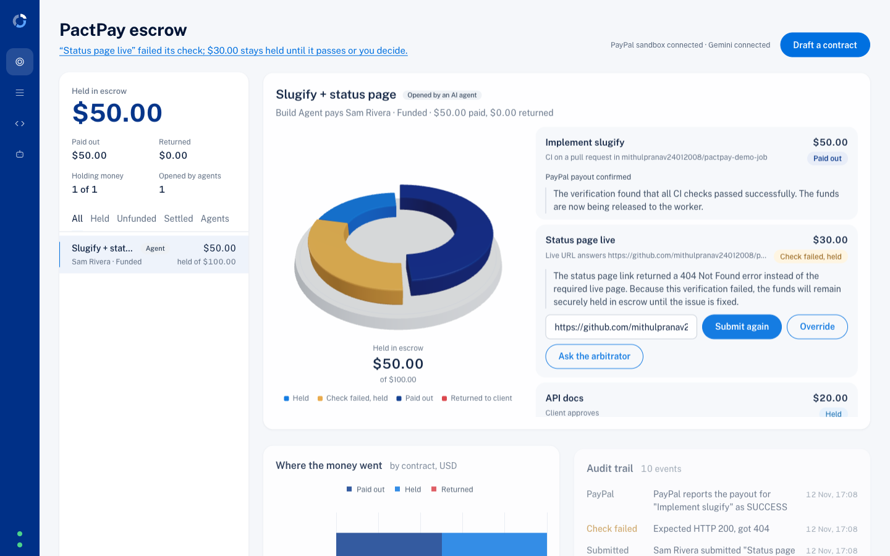
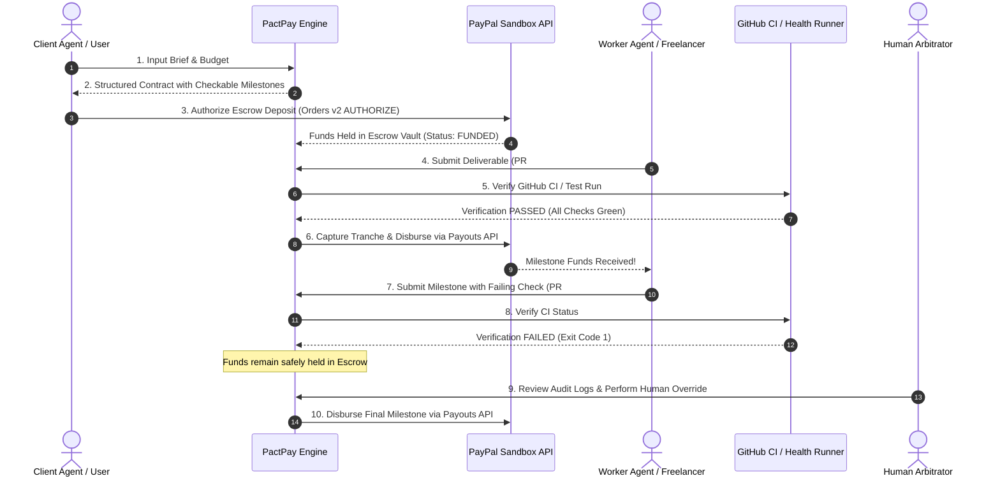

# PactPay: escrow that pays when the work is proven

> **PayPal AI Hackathon 2026** · Agentic Commerce · PayPal + AI · AG Grid

Milestone escrow on PayPal for people and AI agents. The client's money is **held** (PayPal authorization), each milestone is
**released only when a machine-checkable test passes** (CI on a pull request, or a URL that answers), and anything not earned
goes back to the client. Gemini drafts contracts and explains results; **it never decides whether money moves.**



[](LICENSE)
[](https://developer.paypal.com/)
[](https://www.ag-grid.com/)
[](#-for-ai-agents-pactpay-mcp-server)

---

## 💡 The Problem
In the emerging world of **Agentic Commerce**, autonomous AI agents hire human freelancers, contractors, and other AI agents to execute complex tasks (e.g. software features, data pipelines, API integrations). 

However, **bilateral financial trust is broken**:
- Pre-paying creates counterparty risk where the client agent loses funds on bad or incomplete deliverables.
- Post-paying forces the worker agent to work without guaranteed payment.
- Traditional escrow platforms require cumbersome manual human arbitration and cannot programmatically inspect code, CI/CD telemetry, or API contracts.

---

## ⚡ The Solution
**PactPay** is an autonomous milestone escrow protocol and arbitration engine powered by **PayPal Developer APIs** and **AG Grid**:

1. **AI Contract Drafting (Gemini):** A client (person or AI agent) inputs a job brief. Gemini drafts a structured contract with machine-checkable milestones whose amounts add up to the budget.
2. **Client Funds Escrow:** The client funds the contract using **PayPal Orders API v2** with `intent: "AUTHORIZE"`, securely holding funds in escrow without immediate capture.
3. **Deterministic & Automated Milestone Verification:** When a worker submits a deliverable (such as a GitHub Pull Request or deployed endpoint URL), PactPay executes automated deterministic verification checks (CI green checks or HTTP probes). **The AI never arbitrarily decides whether money moves — deterministic checks do.**
4. **Programmatic Payouts:** Upon successful verification, PactPay captures that milestone's tranche and programmatically pays the worker via the **PayPal Payouts API**.
5. **Human-in-the-Loop Override:** If an automated check fails, funds remain held, Gemini explains the result in plain words to both sides, and the client can release anyway or reject the milestone (that share is returned by voiding the remaining authorization).
6. **Deadlines and confirmed payouts:** a milestone that misses its deadline is refunded automatically, and every payout is followed until PayPal confirms it.
7. **AI agents as clients:** an MCP server lets any agent draft, create and fund (via a human-approved PayPal link) a contract, submit work and watch it get paid.
8. **A dashboard that shows where every dollar is:** a live 3D escrow vault, an AG Grid ledger, AG Charts and a full audit trail.

---

## 🏗️ Architecture & Payment Flow



---

## 🛠️ PayPal Developer Platform Integration
- **[PayPal Server SDK](https://www.npmjs.com/package/@paypal/paypal-server-sdk) (`@paypal/paypal-server-sdk`), Orders controller:** create an order with `intent: AUTHORIZE`, then authorize it after the client approves. Funds are held, not captured.
- **PayPal Server SDK, Payments controller:** one **partial capture** per milestone (`final_capture` on the last), and **void** to return what is left when a milestone is rejected.
- **PayPal Payouts API v1 (REST):** pays the worker each milestone's share. The Server SDK has no Payouts controller, so this one call uses REST directly, with idempotent request ids so a retry never pays twice.

## ✅ Verified in the PayPal sandbox
All four paths were run end to end against the live PayPal sandbox:
| Path | Result |
| --- | --- |
| Fund | Client approved $100 in PayPal checkout, funds authorized and held |
| Fail and hold | PR #1 fails CI, $0 released, $100 still held |
| Pass and pay | PR #2 passes CI, $60 captured and paid out (payout batch status SUCCESS) |
| Reject and refund | Milestone URL returns 404, client rejects, remaining authorization voided, $20 returned |
| Agent via MCP + deadline | Contract created and funded through the MCP server; PR passed, $12 paid (PayPal confirmed SUCCESS); second milestone missed its deadline, $8 returned automatically |

## 📊 The dashboard (React Three Fiber · AG Grid · AG Charts)
- **3D escrow vault** (React Three Fiber, rendered only while something moves): each milestone is a ring segment sized by its amount. Held sits in the vault in PayPal blue, a failed check turns amber, paid lifts out in navy, refunded slides away in red. Drag to rotate; click a segment to open that milestone. Falls back to a flat ring without WebGL.
- **AG Grid ledger:** every milestone across every contract (money location, check, amount, deadline, PayPal payout status) with quick search and one-click **CSV and JSON export**; click a row to open it.
- **AG Charts:** "Where the money went", stacked per contract into paid out, held and returned.
- **What needs you:** the line under the title names the one thing to act on (a failed check, the next deadline, an unfunded contract).
- **Dialogs** for drafting with Gemini, overriding a milestone, and asking the AI arbitrator (advisory only).

---

## 🎬 Demo Job Repo for Video & Judges
- **Demo Job Repository:** [pactpay-demo-job](https://github.com/mithulpranav24012008/pactpay-demo-job)
  - **PR #1 (Failing CI):** Demonstrates automated failure detection — funds remain safely held in escrow, with detailed diagnosis.
  - **PR #2 (Passing CI):** Demonstrates automated verification pass — funds captured and disbursed instantly via PayPal Payouts.

---

## 🤖 For AI agents: PactPay MCP server
Any MCP-capable agent (Claude, Cursor, Codex…) can hire and pay through PactPay. With the API running (`npm run dev:server`), add this to the agent's MCP config:

```json
{
  "mcpServers": {
    "pactpay": {
      "command": "npx",
      "args": ["tsx", "/absolute/path/to/pactpay/mcp/src/index.ts"],
      "env": { "PACTPAY_URL": "http://localhost:4000" }
    }
  }
}
```

Tools: `draft_contract`, `create_contract`, `fund_contract`, `submit_work`, `contract_status`, `list_contracts`.
The agent can post a job, hand a human the PayPal approval link, submit work and watch it get paid, but it can never approve a payment itself: funding needs a human in PayPal, and payouts need a passing check.

## ⏰ Deadlines and confirmed payouts
- Each milestone can have a deadline (`due_at`). If nothing has passed by then, PactPay rejects it automatically and that share goes back to the client (the remaining PayPal authorization is voided when the contract closes).
- After a payout, PactPay keeps asking PayPal until the payout is final (`SUCCESS`, `UNCLAIMED`, `FAILED`…) and shows the confirmed state.

## 🧪 Try the API (OpenAPI + Postman)
- [`docs/openapi.yaml`](docs/openapi.yaml): full OpenAPI 3 spec of the PactPay API (validated with Redocly).
- [`docs/pactpay.postman_collection.json`](docs/pactpay.postman_collection.json): import into **Postman** (File → Import) to call every endpoint with example bodies; `baseUrl` defaults to `http://localhost:4000`. Also runs headless: `npx newman run docs/pactpay.postman_collection.json --folder System`.

## Known limitations
- The API has no authentication: it is a local demo for judging. A production version would authenticate clients and workers and scope overrides to the client.
- PayPal authorizations are honored for 3 days; milestones captured later may need re-authorization.
- A "partial settlement" AI recommendation is advisory; there is no one-click partial release yet.

## 🚀 Run it locally (about 5 minutes)

**Needs:** Node.js 22.5+ (uses the built-in `node:sqlite`), a free PayPal developer account, and a free Gemini API key.

1. **PayPal sandbox** (developer.paypal.com):
   - Testing Tools → Sandbox Accounts → create a **Business** account with Country **United States** (it sends payouts; payouts are not available from some countries, e.g. India).
   - Create two **Personal** US accounts: one pays as the client, one is paid as the worker.
   - Apps & Credentials → Sandbox → **Create App** on that US business account, with **Payouts** ticked. Copy the Client ID and Secret.
2. **Gemini key:** aistudio.google.com → Get API key (no card needed).
3. **Configure and start:**
   ```bash
   git clone https://github.com/mithulpranav24012008/pactpay && cd pactpay
   cp .env.example .env        # fill PAYPAL_CLIENT_ID, PAYPAL_CLIENT_SECRET, GEMINI_API_KEYS
   npm install
   npm run dev:server          # API on http://localhost:4000
   npm run dev:web             # dashboard on http://localhost:5173
   ```
4. **Try the demo:** open http://localhost:5173, draft a contract from a brief, set the worker email to your worker sandbox account, fund it (log in as the client sandbox account), then submit
   `https://github.com/mithulpranav24012008/pactpay-demo-job/pull/1` (fails, money stays held) and
   `https://github.com/mithulpranav24012008/pactpay-demo-job/pull/2` (passes, worker is paid).

`GET http://localhost:4000/api/health` shows whether the PayPal and Gemini keys were picked up. API reference: [docs/API.md](docs/API.md).

## 📄 License
This project is licensed under the MIT License - see the [LICENSE](LICENSE) file for details.

## Optional: deploy to Render
`render.yaml` is a Render Blueprint (not required to run or judge the project): one free web service that runs the API and serves the dashboard.
In Render: **New → Blueprint**, pick this repo, then fill in `PUBLIC_URL` (the service URL, e.g.
`https://pactpay.onrender.com`), `PAYPAL_CLIENT_ID`, `PAYPAL_CLIENT_SECRET`, `GEMINI_API_KEYS`, and optionally `GITHUB_TOKEN`.
The free plan's disk is temporary, so contracts reset when the service restarts.
