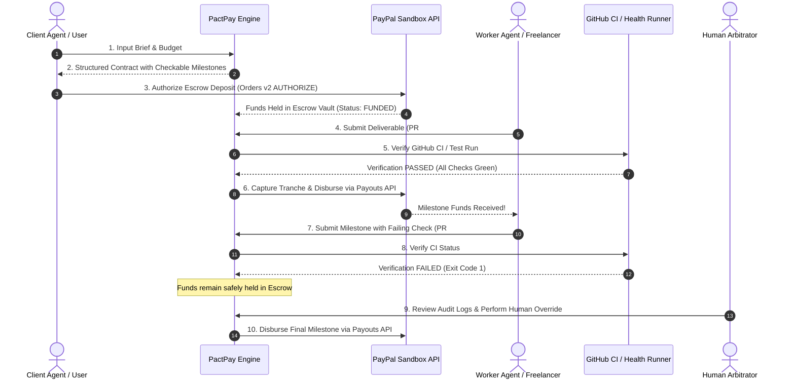

# PactPay: Autonomous Milestone Escrow & Deliverable Verification

> **PayPal AI Hackathon 2026**  
> *Target Categories: Grand Prize | Best Use of Agentic Commerce ($5,000) | AG Grid Sponsor Prize ($5,000)*

[](LICENSE)
[](https://www.ag-grid.com/)
[](https://developer.paypal.com/)

---

## 💡 The Problem
In the emerging world of **Agentic Commerce**, autonomous AI agents hire human freelancers, contractors, and other AI agents to execute complex tasks (e.g. software features, data pipelines, API integrations). 

However, **bilateral financial trust is broken**:
- Pre-paying creates counterparty risk where the client agent loses funds on bad or incomplete deliverables.
- Post-paying forces the worker agent to work without guaranteed payment.
- Traditional escrow platforms require cumbersome manual human arbitration and cannot programmatically inspect code, CI/CD telemetry, or API contracts.

---

## ⚡ The Solution
**PactPay** is an autonomous milestone escrow protocol and arbitration engine powered by **PayPal Developer APIs** and **AG Grid**:

1. **AI Contract Drafting:** A client (person or AI agent) inputs a job brief. The agent drafts a structured contract with machine-checkable milestones.
2. **Client Funds Escrow:** The client funds the contract using **PayPal Orders API v2** with `intent: "AUTHORIZE"`, securely holding funds in escrow without immediate capture.
3. **Deterministic & Automated Milestone Verification:** When a worker submits a deliverable (such as a GitHub Pull Request or deployed endpoint URL), PactPay executes automated deterministic verification checks (CI green checks or HTTP probes). **The AI never arbitrarily decides whether money moves — deterministic checks do.**
4. **Programmatic Payouts:** Upon successful verification, PactPay captures that milestone's tranche and programmatically pays the worker via the **PayPal Payouts API**.
5. **Human-in-the-Loop Override:** If an automated check fails, funds remain safely held in escrow, with a transparent audit log and one-click human arbitrator resolution.
6. **Interactive Telemetry Dashboard (AG Grid):** A high-performance real-time telemetry console built with **AG Grid**, allowing clients and arbitrators to inspect contract states, live milestone tranches, and verification logs.

---

## 🏗️ Architecture & Payment Flow



---

## 🛠️ PayPal Developer Sandbox Integration
PactPay integrates directly with core PayPal Developer Platform APIs:
- **PayPal OAuth 2.0 (`/v1/oauth2/token`):** Secure server-to-server token negotiation with client credentials.
- **PayPal Orders API v2 (`/v2/checkout/orders`):** Used with `intent: "AUTHORIZE"` to establish verifiable escrow commitments from client wallets.
- **PayPal Authorizations & Captures (`/v2/payments/authorizations/{id}/capture`):** Locks and guarantees funds in the platform escrow pool with partial captures per milestone.
- **PayPal Payouts API v1 (`/v1/payments/payouts`):** Programmatic milestone disbursements directly into worker PayPal or Venmo accounts with idempotent batch headers.

---

## 📊 AG Grid Sponsor Feature
PactPay's telemetry dashboard utilizes **AG Grid** to provide:
- **Contract Matrix:** Real-time grid displaying contract values, escrow status, PayPal order references, and client/worker metadata.
- **Milestone Inspector:** Sub-grid detailing milestone tranches, verification engine types, deliverable URLs, and PayPal payout IDs.
- **Audit Feed:** Real-time event log streaming arbitrator decisions, cryptographic hashes, and verification latencies.

---

## 🎬 Demo Job Repo for Video & Judges
- **Demo Job Repository:** [pactpay-demo-job](https://github.com/mithulpranav24012008/pactpay-demo-job)
  - **PR #1 (Failing CI):** Demonstrates automated failure detection — funds remain safely held in escrow, with detailed diagnosis.
  - **PR #2 (Passing CI):** Demonstrates automated verification pass — funds captured and disbursed instantly via PayPal Payouts.

---

## 🚀 Quick Start Guide

### 1. Prerequisites
- Node.js 22.5+ (uses native `node:sqlite`)
- (Optional) PayPal Developer Sandbox account (`PAYPAL_CLIENT_ID` and `PAYPAL_CLIENT_SECRET`) with **Payouts** enabled.

### 2. Installation
```bash
cp .env.example .env
npm install
```

### 3. Run Development Servers
```bash
# Start backend API on :4000
npm run dev:server

# Start Vite + React + AG Grid dashboard on :5173
npm run dev:web
```

---

## 📄 License
This project is licensed under the MIT License - see the [LICENSE](LICENSE) file for details.

## Deploy (Render)
`render.yaml` is a Render Blueprint: one free web service that runs the API and serves the dashboard.
In Render: **New → Blueprint**, pick this repo, then fill in `PUBLIC_URL` (the service URL, e.g.
`https://pactpay.onrender.com`), `PAYPAL_CLIENT_ID`, `PAYPAL_CLIENT_SECRET`, `GEMINI_API_KEYS`, and optionally `GITHUB_TOKEN`.
The free plan's disk is temporary, so contracts reset when the service restarts.
